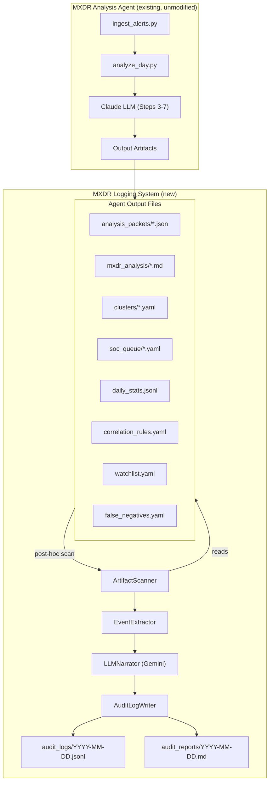

# LLM-Based Audit Logging System for MXDR Analysis Agent

Build an intelligent audit logging system in `MXDR_logging/` that observes, parses, and processes every action and insight from the MXDR_analysis_agent pipeline, producing maximally verbose, human-readable audit logs enhanced by LLM interpretation.

## User Review Required

> [!IMPORTANT]
> **LLM Provider Choice**: This plan uses **Google Gemini** (`google-generativeai` Python SDK) — free tier allows 15 RPM / 1M tokens/day with only an API key. This is the best free-tier option available. Alternative: **Groq** (free tier, Llama models). Do you have a preference?

> [!IMPORTANT]
> **Non-actionable logging**: Per your requirement, the system will **only log events** — it will not suggest, recommend, or trigger any actions based on the logs. Logs are purely observational audit records.

> [!WARNING]
> **API Key Required**: You'll need a Google Gemini API key (free at [aistudio.google.com](https://aistudio.google.com)). The system will set it via `GEMINI_API_KEY` in a `.env` file.

## Open Questions

> [!IMPORTANT]
> **Integration approach**: Should the logging system be:
> - **(A) Post-hoc log reader** — Reads existing output files (`analysis_packets/*.json`, `mxdr_analysis/*.md`, `clusters/*.yaml`, `soc_queue/*.yaml`, `daily_stats.jsonl`, correlation rules) after `run_daily_analysis.sh` completes, and produces an audit log from the artifacts?
> - **(B) Inline instrumentation** — Modifies the analysis agent source files to emit events in real-time via a shared logging hook?
>
> **This plan implements option (A)** — a standalone post-hoc system that reads analysis artifacts without modifying the agent codebase. This is cleaner, non-invasive, and can be run independently.

> [!IMPORTANT]
> **Log output format**: The plan produces both:
> 1. A structured JSON log (machine-parseable, append-only JSONL)
> 2. A human-readable Markdown audit report (the primary deliverable, LLM-enhanced)
>
> Is this acceptable, or do you want only one format?

---

## Architecture Overview



---

## Proposed Changes

### Core Package — `MXDR_logging/`

---

#### [NEW] [config.py](file:///c:/Users/eugen/Projects/MXDR_logging/config.py)

Configuration management:
- Load `.env` for `GEMINI_API_KEY` and `MXDR_AGENT_ROOT` (path to `MXDR_analysis_agent/`)
- Default paths for log output directories
- LLM model selection (`gemini-2.0-flash` — fastest free model)
- Log verbosity settings

---

#### [NEW] [events.py](file:///c:/Users/eugen/Projects/MXDR_logging/events.py)

Event taxonomy — defines all detectable event types as dataclasses:

| Event Category | Events Detected |
|---|---|
| **Ingestion** | `ALERTS_INGESTED` — alerts downloaded and saved to DuckDB (count, severity breakdown, time range) |
| **Pre-Analysis** | `ANALYSIS_PACKET_GENERATED` — correlation rules executed, packet written (stats, rule hit counts, watchlist hits, notable alert count) |
| **Correlation Rules** | `RULE_TRIGGERED` — each CR-001…CR-008 that fired (rule ID, hit details, entities involved) |
| **Correlation Rules** | `RULE_NOT_TRIGGERED` — rules that were checked but had no hits |
| **Watchlist** | `WATCHLIST_HIT` — entity matched a watchlist entry (entity type/value, reason, alert context) |
| **Clustering** | `CLUSTERS_GENERATED` — suspicious alert clusters identified (cluster count, per-cluster alert IDs, priority) |
| **Prioritization** | `SOC_QUEUE_GENERATED` — priority-sorted SOC action items created (P1/P2/P3 counts, top items) |
| **Reporting** | `NARRATIVE_REPORT_WRITTEN` — daily analysis report produced (file path, word count, key sections) |
| **Rule Updates** | `RULE_CONFIDENCE_UPDATED` — correlation rule confidence adjusted (rule ID, old → new confidence, hit_count, last_triggered) |
| **Rule Updates** | `RULE_RETIRED` — correlation rule confidence dropped below 0.20 |
| **Watchlist Updates** | `WATCHLIST_UPDATED` — watchlist entries added/modified/expired |
| **False Negatives** | `FALSE_NEGATIVE_RECORDED` — new confirmed false negative appended |
| **Statistics** | `DAILY_STATS_APPENDED` — daily summary stats line appended to JSONL |
| **Anomaly Detection** | `NEW_ALERT_TITLE_DETECTED` — alert title not seen in prior 7 days |
| **Anomaly Detection** | `VOLUME_SPIKE_DETECTED` — category volume exceeded 7-day rolling average |
| **Entity Insights** | `HIGH_RISK_ENTITY_OBSERVED` — entity appeared in multiple high-severity alerts across incidents |
| **Pipeline Metadata** | `PIPELINE_RUN_STARTED` / `PIPELINE_RUN_COMPLETED` — overall run timing and status |

Each event is a `@dataclass` with:
- `event_id: str` — UUID
- `timestamp: str` — ISO 8601
- `event_type: str` — from the table above
- `severity: str` — INFO / WARNING / CRITICAL
- `source_file: str` — which artifact file the event was extracted from
- `details: dict` — event-specific structured data
- `raw_snippet: str` — relevant excerpt from the source file

---

#### [NEW] [scanner.py](file:///c:/Users/eugen/Projects/MXDR_logging/scanner.py)

`ArtifactScanner` class — reads and parses the MXDR analysis agent's output artifacts for a given date:

1. **Analysis packet** (`data/analysis_packets/YYYY-MM-DD.json`):
   - Extracts `stats`, `hourly`, `rule_hits`, `watchlist_hits`, `notable_alerts`
   - Generates `ANALYSIS_PACKET_GENERATED`, `RULE_TRIGGERED` / `RULE_NOT_TRIGGERED`, `WATCHLIST_HIT` events

2. **Clusters** (`data/clusters/YYYY-MM-DD.yaml`):
   - Parses cluster definitions, alert groupings, priorities
   - Generates `CLUSTERS_GENERATED` events

3. **SOC queue** (`data/soc_queue/YYYY-MM-DD.yaml`):
   - Parses priority items
   - Generates `SOC_QUEUE_GENERATED` events

4. **Narrative report** (`mxdr_analysis/YYYY-MM-DD.md`):
   - Reads the markdown report, extracts section headers and key statistics
   - Generates `NARRATIVE_REPORT_WRITTEN` events

5. **Correlation rules** (`rules/correlation_rules.yaml`):
   - Compares current state with a cached snapshot from the previous run
   - Generates `RULE_CONFIDENCE_UPDATED` / `RULE_RETIRED` events

6. **Watchlist** (`rules/watchlist.yaml`):
   - Compares with cached snapshot
   - Generates `WATCHLIST_UPDATED` events

7. **False negatives** (`data/false_negatives.yaml`):
   - Compares with cached snapshot
   - Generates `FALSE_NEGATIVE_RECORDED` events

8. **Daily stats** (`data/daily_stats.jsonl`):
   - Reads the latest line
   - Generates `DAILY_STATS_APPENDED` and detects `VOLUME_SPIKE_DETECTED` by comparing with historical entries

---

#### [NEW] [narrator.py](file:///c:/Users/eugen/Projects/MXDR_logging/narrator.py)

`LLMNarrator` class — uses Google Gemini to transform structured events into verbose, human-readable audit narratives:

- **Input**: List of `AuditEvent` dataclasses for a given date
- **Output**: A rich Markdown audit report with:
  - Executive summary of the day's pipeline run
  - Per-event verbose narration explaining *what happened*, *why it matters*, and *what the data shows*
  - Timeline view of all events in chronological order
  - Statistical highlights and trend observations
  - Entity activity summaries (which IPs, users, devices were most active)

- **LLM Prompt Strategy**:
  - System prompt establishes the narrator as an expert MXDR audit analyst
  - Events are batched into context windows (Gemini 2.0 Flash supports 1M tokens)
  - Each event batch gets a structured prompt asking for verbose, plain-English narration
  - Fallback: If API is unavailable, produces a template-based narrative without LLM enhancement

- **Token Management**:
  - Single API call with all events for the day (typical day = ~2K tokens of events)
  - Response capped at 8K tokens for thorough narration
  - Total cost: $0 (within Gemini free tier)

---

#### [NEW] [writer.py](file:///c:/Users/eugen/Projects/MXDR_logging/writer.py)

`AuditLogWriter` class — writes two outputs:

1. **JSONL log** (`audit_logs/YYYY-MM-DD.jsonl`):
   - One JSON object per event, append-only
   - Fields: event_id, timestamp, event_type, severity, source_file, details, llm_narrative

2. **Markdown report** (`audit_reports/YYYY-MM-DD.md`):
   - Full LLM-narrated audit report
   - Sections: Pipeline Summary, Event Timeline, Correlation Rule Activity, Entity Intelligence, Anomaly Report, Statistics Dashboard

---

#### [NEW] [main.py](file:///c:/Users/eugen/Projects/MXDR_logging/main.py)

CLI entry point:
```bash
# Process a specific date
python -m MXDR_logging.main --date 2026-03-25 --agent-root /path/to/MXDR_analysis_agent

# Process yesterday (for cron)
python -m MXDR_logging.main --yesterday --agent-root /path/to/MXDR_analysis_agent

# Dry run (extract events but skip LLM narration)
python -m MXDR_logging.main --date 2026-03-25 --dry-run
```

Orchestrates: `ArtifactScanner` → `LLMNarrator` → `AuditLogWriter`

---

#### [NEW] [.env](file:///c:/Users/eugen/Projects/MXDR_logging/.env)

```env
GEMINI_API_KEY=your-api-key-here
MXDR_AGENT_ROOT=c:\Users\eugen\Projects\MXDR_analysis_agent
```

---

#### [NEW] [requirements.txt](file:///c:/Users/eugen/Projects/MXDR_logging/requirements.txt)

```
google-generativeai>=0.8.0
python-dotenv>=1.0.0
pyyaml>=6.0
```

---

#### [NEW] [__init__.py](file:///c:/Users/eugen/Projects/MXDR_logging/__init__.py)

Package init with version string.

---

### Supporting Files

---

#### [NEW] [snapshots/](file:///c:/Users/eugen/Projects/MXDR_logging/snapshots/)

Directory to cache previous-run state of `correlation_rules.yaml`, `watchlist.yaml`, `false_negatives.yaml` — used for diff-based change detection.

---

#### [NEW] [audit_logs/](file:///c:/Users/eugen/Projects/MXDR_logging/audit_logs/)

Output directory for structured JSONL event logs.

---

#### [NEW] [audit_reports/](file:///c:/Users/eugen/Projects/MXDR_logging/audit_reports/)

Output directory for human-readable Markdown audit reports.

---

## Example Audit Report Output

The LLM-narrated Markdown report will look like:

```markdown
# 🔍 MXDR Audit Log — 2026-03-25

**Pipeline Run**: Started 10:30:12 UTC — Completed 10:34:47 UTC (4m 35s)
**Analysis Date**: 2026-03-25
**Generated At**: 2026-03-25T10:35:01Z

---

## Executive Summary

The daily MXDR analysis pipeline processed **1,056 security alerts** across
**47 distinct incidents** on March 25, 2026. Of these, **48 non-noisy alerts**
were identified for deeper analysis after filtering out mass-download and
CC_DSPM policy noise. The correlation engine detected activity matching
**3 correlation rules** (CR-003, CR-004, CR-005), and **2 watchlist entities**
were observed in active alerts...

## Event Timeline

### 10:30:12 — Alert Ingestion Complete
**1,056 alerts** were successfully downloaded from the Microsoft Graph Security
API and persisted to the local DuckDB store. Severity breakdown: **12 high**,
**36 medium**, **998 low**, **10 informational**. The high-severity alerts
warrant immediate attention as they represent potential active threats...

### 10:31:45 — Correlation Rule CR-003 Triggered
**Rule CR-003** (Single IP → 5+ distinct users within 48h) matched IP address
`203.0.113.45`, which was associated with **7 distinct user accounts** across
**4 separate incidents** within a 36-hour window. This pattern is consistent
with credential spraying or lateral movement activity...

[... continues with all events ...]

## Correlation Rule Activity

| Rule | Status | Hits | Confidence | Change |
|------|--------|------|------------|--------|
| CR-001 | No Hit | 0 | 0.85 | — |
| CR-003 | **TRIGGERED** | 1 | 0.87 | +0.02 ↑ |
| CR-004 | **TRIGGERED** | 3 | 0.72 | +0.03 ↑ |
| CR-005 | **TRIGGERED** | 1 | 0.65 | +0.04 ↑ |

## Statistics

- Total alerts: 1,056
- Non-noisy alerts: 48
- Suspicious clusters: 6
- P1 (investigate today): 2
- P2 (investigate this week): 3
- P3 (monitor): 1
- Correlation rules triggered: 3
```

---

## Verification Plan

### Automated Tests
```bash
# Install dependencies
cd c:\Users\eugen\Projects\MXDR_logging
pip install -r requirements.txt

# Run the logging system against existing analysis artifacts
python -m MXDR_logging.main --date 2026-03-25 --agent-root c:\Users\eugen\Projects\MXDR_analysis_agent

# Verify outputs exist
ls audit_logs/
ls audit_reports/
```

### Manual Verification
- Inspect `audit_reports/YYYY-MM-DD.md` for human readability and completeness
- Verify that all 16+ event types are detected from the analysis artifacts
- Confirm JSONL log entries match the narrative report
- Test with `--dry-run` to verify event extraction without LLM calls
- Test LLM fallback by providing an invalid API key
